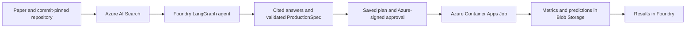

# Production Build from Research Papers (PBRP)

PBRP is an Azure-based agent workflow that turns a machine learning paper and its source repository into an evidence-backed experiment plan. It uses retrieval-augmented generation (RAG) to answer questions and extract requirements, then runs an approved benchmark in Azure Container Apps Jobs and displays the results in Microsoft Foundry.

I built PBRP to learn how to connect research evidence, an approved experiment plan, and a cloud execution so that someone else can inspect the result and repeat the run.

## Verified LoRA benchmark

The first end-to-end run evaluated GPT-2 Medium with the authors’ released LoRA adapter on the first 50 distinct inputs from the E2E NLG test set. [LoRA paper](https://arxiv.org/abs/2106.09685) · [Released GPT-2 adapters](https://github.com/microsoft/LoRA/releases/tag/GPT-2)

| Measurement | Observed result |
| --- | --- |
| Azure job status | Succeeded |
| BLEU | **72.37 / 100** |
| Distinct test inputs | 50 |
| Human reference descriptions | 322 |
| Hardware | One NVIDIA T4 GPU |

Foundry displayed the execution status, score, and a generated restaurant description alongside a human reference. The job wrote the full predictions and metrics to private Azure Blob Storage.

## How it works



1. **Ingest** the PDF and a commit-pinned repository. The ingestion service reads repository files as static evidence and indexes the selected text in Azure AI Search.
2. **Retrieve and extract** using hybrid keyword and vector search with semantic ranking. The Foundry agent answers questions with citations and builds a structured `ProductionSpec` with source locators, evidence, confidence scores, and explicit gaps.
3. **Approve and run** the saved plan through the Azure-signed CLI. The CLI checks the plan ID, SHA-256 hash, and configured container image digest before starting the manual job.
4. **Inspect** the linked execution status, BLEU score, and generated example in Foundry. The execution name matches the results folder in Blob Storage.

## Run the workflow

The quickstart assumes a configured Microsoft Foundry project, an Azure AI Search index with the pinned LoRA inputs, Blob Storage, and a manual Container Apps Job configured with the benchmark image. The operator and hosted agent use Azure identities with scoped permissions.

### 1. Prepare the project terminal

Use Python 3.13 to match the hosted runtime. From the project root, install the package, sign in to Azure, and load your configured development environment.

```bash
python3.13 -m venv .venv
source .venv/bin/activate
python -m pip install -e .
az login

set -a
source .azure/dev/.env
set +a
```

The approval and status CLI reads these settings:

| Variable | Value |
| --- | --- |
| `AZURE_STORAGE_ENDPOINT` | Blob Storage account endpoint |
| `PBRP_E2E_JOB_ID` | Azure resource ID of the manual benchmark job |
| `PBRP_E2E_IMAGE` | Digest-pinned benchmark image in Azure Container Registry |

The hosted agent also uses `FOUNDRY_PROJECT_ENDPOINT`, `AZURE_AI_MODEL_DEPLOYMENT_NAME`, `AZURE_SEARCH_ENDPOINT`, and `PBRP_DEFAULT_RUN_ID` to resolve its Foundry deployment, search service, and indexed paper and repository.

### 2. Ask a question or prepare a benchmark

In the Foundry Playground, start with either command.

```text
ask How does LoRA adapt a pretrained model?
benchmark
```

`ask` returns a cited answer from the pinned LoRA paper. `benchmark` answers two paper questions, extracts the GPT-2 E2E NLG requirements, and returns a saved plan with its ID and SHA-256 hash.

### 3. Approve and view the result

Review the plan and use the approval command printed by the agent. Replace the placeholders with the values from the current plan.

```bash
pbrp-benchmark approve --plan-id "<PLAN_ID>" --sha256 "<PLAN_SHA256>"
```

Check progress and view the results in the Foundry Playground.

```text
benchmark-result <PLAN_ID>
```

You can also run `pbrp-benchmark status --plan-id "<PLAN_ID>"` in the project terminal. For the Azure job’s history, open the job under **Container App Jobs → Monitoring → Execution history**. After it succeeds, open `<execution-name>/metrics.json` and `<execution-name>/examples.tsv` in the configured results container. [Azure Container Apps Jobs documentation](https://learn.microsoft.com/en-us/azure/container-apps/jobs)

For a smaller infrastructure check, `plan` prepares the separate synthetic LoRA CPU smoke test.

## Technology stack

- **Agent and RAG** · Python, LangGraph, Pydantic, Microsoft Foundry SDK, Responses API, Azure AI Search, and `text-embedding-3-small`
- **Azure infrastructure** · Azure Container Apps Jobs, Azure Container Registry, Azure Blob Storage, Bicep, Azure CLI, and Azure Developer CLI
- **Identity and evaluation** · Managed identities, Azure RBAC, PyTorch, CUDA, LoRA, and BLEU

## Repository layout

| Path | Responsibility |
| --- | --- |
| `src/pbrp/ingest/` | Paper and pinned repository ingestion |
| `src/pbrp/rag/` and `src/pbrp/spec/` | Cited question answering and structured requirement extraction |
| `src/pbrp/graph/` | Hosted LangGraph workflow |
| `src/pbrp/providers/` | Azure Search, Foundry, Blob Storage, and job integrations |
| `src/pbrp/benchmark_cli.py` | Azure-signed approval and benchmark status commands |
| `infra/` | Bicep templates for storage, job infrastructure, and role assignments |
| `azure.yaml` | Foundry hosted-agent deployment configuration |

For a hosted deployment from a fresh checkout, supply the local extraction prompts under `src/pbrp/agents/prompts/` and configure the Azure resources referenced by `azure.yaml`. The benchmark expects a prebuilt image and an existing job. [Host LangGraph agents in Microsoft Foundry](https://learn.microsoft.com/en-us/azure/foundry/how-to/develop/langchain-hosted-agents)
